# Spotify cache database

This document describes the SQLite database that caches the parts of your Spotify library the genre sorter needs. It explains the tables, how they connect, and why the cache exists.

`src/sgs/spotify_cache.py` is the entry point, `SpotifyCache`. The work is split across modules in `src/sgs/cache/`:

| Module | Responsibility |
|---|---|
| `schema.py` | Table definitions |
| `playlist_cache.py` | Playlists and their songs |
| `library_cache.py` | Liked songs and saved albums |
| `top_track_cache.py` | Top tracks per time range |
| `track_store.py` | Saving songs and artists, shared by all sources |
| `source_links.py` | The `song_sources` rows, shared by all sources |
| `song_reader.py` | Reading cached songs back out |
| `sync_stats.py` | Counts and timing logged after each sync |

The database file is `data/spotify_cache.db`.

## Why a cache

Spotify's API is slow when you ask for many songs. Your playlists hold thousands of songs, and each playlist's items come back in pages of 50, so reading everything takes many requests on every run. Most of those playlists haven't changed since the last run, so most of those requests return data we already have.

The cache avoids that repeat work in two ways:

- **Playlists:** each playlist stores the `snapshot_id` Spotify returned the last time its songs were read. Spotify changes that value whenever the playlist changes. On the next run, a playlist is re-read only if its `snapshot_id` is different.
- **Liked songs and saved albums:** each saved item stores its `added_at` date. The list is ordered newest first, so a run reads from the top and stops at the first item already cached. A saved album's tracks are fetched once, when the album is first seen.
- **Top tracks:** the ranking is re-read only when the cached one is older than 24 hours (`TOP_TRACKS_MAX_AGE_HOURS`), because a ranking has no change marker.
- **Genre responses:** each artist keeps the raw JSON returned by MusicBrainz and by Last.fm, one row per source. A source is asked again only for artists it has not answered yet.

Removals are detected by comparing the cached count with the `total` Spotify reports. If they differ, the whole list is read again.

## A subset of the Spotify data

The database is not a copy of your Spotify account. The parsed tables store only the songs, artists, and playlists this app needs to group songs by genre. They drop the rest, such as album art, follower counts, and playback details.

The raw tables are the exception. They keep the track, album, and simplified artist objects exactly as Spotify returned them, and the MusicBrainz and Last.fm responses in full. That gives a backup for re-parsing later, and it keeps fields that Spotify may remove.

The parsed tables are shaped for the questions the app asks. Those questions are:

- Which songs are in each playlist, and in what order?
- Which artists made each song?
- Which genres belong to each artist?

Because the tables are linked by shared key columns, the answers come from local queries, not from new API calls.

## Key colors and legend

Markdown on GitHub cannot color text, so the tables use colored markers instead.

| Marker | Meaning |
|---|---|
| 🟦 | **Primary key**: uniquely identifies a row in this table |
| 🟧 | **Foreign key**: refers to a primary key in another table |
| 🟩 | **Join key**: a column shared by two tables, used to combine them |
| ⬜ | Regular column |

Key columns use the same name in every table. For example, `song_id` is the primary key of `songs` and a foreign key in `song_artists`, `playlist_songs`, and `song_sources`. If two tables share a column name, you can join them on that column.

## Entity relationship diagram

```mermaid
erDiagram
    songs ||--o{ song_artists : "has"
    artists ||--o{ song_artists : "performs"
    artists ||--o{ artist_genres : "has"
    artists ||--o{ artist_genre_responses : "has raw response from"
    genres ||--o{ artist_genres : "describes"
    playlists ||--o{ playlist_songs : "contains"
    songs ||--o{ playlist_songs : "appears in"
    songs ||--o{ song_sources : "comes from"
    songs ||--o| raw_tracks : "kept as"
    artists ||--o| raw_artists : "kept as"
    library_items ||--o{ album_songs : "contains"
    songs ||--o{ album_songs : "appears in"
    songs ||--o{ top_track_rankings : "ranked in"

    songs {
        TEXT song_id PK
        TEXT name
        TEXT uri
    }
    artists {
        TEXT artist_id PK
        TEXT name
    }
    artist_genre_responses {
        TEXT artist_id PK, FK
        TEXT source PK
        TIMESTAMP fetched_at
        TEXT status
        TEXT payload
    }
    genres {
        TEXT genre_name PK
    }
    artist_genres {
        TEXT artist_id PK, FK
        TEXT genre_name PK, FK
    }
    song_artists {
        TEXT song_id PK, FK
        TEXT artist_id PK, FK
        INTEGER position
    }
    playlists {
        TEXT playlist_id PK
        TEXT name
        TEXT owner_id
        BOOLEAN collaborative
        TEXT snapshot_id
        TIMESTAMP synced_at
    }
    playlist_songs {
        TEXT playlist_id PK, FK
        INTEGER position PK
        TEXT song_id FK
    }
    library_items {
        TEXT source_name PK
        TEXT item_id PK
        TIMESTAMP added_at
    }
    album_songs {
        TEXT album_id PK, FK
        INTEGER position PK
        TEXT song_id FK
    }
    top_track_rankings {
        TEXT time_range PK
        INTEGER position PK
        TEXT song_id FK
        TIMESTAMP fetched_at
    }
    song_sources {
        TEXT song_id PK, FK
        TEXT source_name PK
    }
    raw_tracks {
        TEXT song_id PK
        TIMESTAMP fetched_at
        TEXT payload
    }
    raw_albums {
        TEXT album_id PK
        TIMESTAMP fetched_at
        TEXT payload
    }
    raw_artists {
        TEXT artist_id PK
        TIMESTAMP fetched_at
        TEXT payload
    }
```



## Tables

### songs

One row per Spotify track. Different releases of the same song have different `song_id` values, so they stay separate.

| Column | Type | Key | Description |
|---|---|---|---|
| `song_id` | TEXT | 🟦 PK | Spotify track ID |
| `name` | TEXT | | Track title |
| `uri` | TEXT | | Spotify URI, such as `spotify:track:...` |

### artists

One row per Spotify artist. Genres are attached to artists, not to songs.

| Column | Type | Key | Description |
|---|---|---|---|
| `artist_id` | TEXT | 🟦 PK | Spotify artist ID |
| `name` | TEXT | | Artist name |

### genres

One row per genre name, such as `dream pop`. This table exists so that each genre name is stored once.

| Column | Type | Key | Description |
|---|---|---|---|
| `genre_name` | TEXT | 🟦 PK | Genre name as Spotify returns it |

### artist_genres

Links artists to genres. An artist can have many genres, and a genre can belong to many artists.

| Column | Type | Key | Description |
|---|---|---|---|
| `artist_id` | TEXT | 🟦🟧 PK, FK | Refers to `artists.artist_id` |
| `genre_name` | TEXT | 🟦🟧 PK, FK | Refers to `genres.genre_name` |

### song_artists

Links songs to artists. A song can have several artists, and `position` keeps their order.

| Column | Type | Key | Description |
|---|---|---|---|
| `song_id` | TEXT | 🟦🟧 PK, FK | Refers to `songs.song_id` |
| `artist_id` | TEXT | 🟦🟧 PK, FK | Refers to `artists.artist_id` |
| `position` | INTEGER | | Order of the artist on the song. `0` is the primary artist. |

### playlists

One row per playlist you can read. `snapshot_id` tells the cache whether the playlist has changed.

| Column | Type | Key | Description |
|---|---|---|---|
| `playlist_id` | TEXT | 🟦 PK | Spotify playlist ID |
| `name` | TEXT | | Playlist name |
| `owner_id` | TEXT | | Spotify user ID of the owner |
| `collaborative` | BOOLEAN | | Whether the playlist is collaborative |
| `snapshot_id` | TEXT | | Version of the playlist when its songs were last read |
| `synced_at` | TIMESTAMP | | When this app last read the playlist's songs |

### playlist_songs

Links playlists to songs, in playlist order. The same song can appear more than once in a playlist, so the key is `position`, not `song_id`.

| Column | Type | Key | Description |
|---|---|---|---|
| `playlist_id` | TEXT | 🟦🟧 PK, FK | Refers to `playlists.playlist_id` |
| `position` | INTEGER | 🟦 PK | Position of the entry in the playlist |
| `song_id` | TEXT | 🟧 FK | Refers to `songs.song_id` |

### song_sources

Records where each song was found. A song can come from several sources, and this table keeps all of them.

| Column | Type | Key | Description |
|---|---|---|---|
| `song_id` | TEXT | 🟦🟧 PK, FK | Refers to `songs.song_id` |
| `source_name` | TEXT | 🟦 PK | One of `liked_songs`, `saved_albums`, `top_tracks`, `your_playlists` |

### library_items

One row per liked song or saved album. `item_id` is a track ID for `liked_songs` and an album ID for `saved_albums`. `added_at` is the date Spotify returns for the item, and it is how the cache tells whether an item is already known.

| Column | Type | Key | Description |
|---|---|---|---|
| `source_name` | TEXT | 🟦 PK | `liked_songs` or `saved_albums` |
| `item_id` | TEXT | 🟦 PK | Track ID for liked songs, album ID for saved albums |
| `added_at` | TIMESTAMP | | When the item was added to the library |

### album_songs

Links a saved album to its tracks, in album order. Each album's tracks are fetched once and kept until the album is removed.

| Column | Type | Key | Description |
|---|---|---|---|
| `album_id` | TEXT | 🟦🟧 PK, FK | Album ID, the same value as `library_items.item_id` for saved albums |
| `position` | INTEGER | 🟦 PK | Position of the track on the album |
| `song_id` | TEXT | 🟧 FK | Refers to `songs.song_id` |

### top_track_rankings

The top tracks for each time range, in ranking order. `fetched_at` decides whether the ranking is still fresh.

| Column | Type | Key | Description |
|---|---|---|---|
| `time_range` | TEXT | 🟦 PK | `short_term`, `medium_term`, or `long_term` |
| `position` | INTEGER | 🟦 PK | Rank of the track, `0` is the top track |
| `song_id` | TEXT | 🟧 FK | Refers to `songs.song_id` |
| `fetched_at` | TIMESTAMP | | When this ranking was read from Spotify |

### artist_genre_responses

The raw JSON that MusicBrainz and Last.fm returned for each artist, one row per artist and source. `status` says what the source answered, and `payload` holds the response as it came back. Nothing is parsed here yet.

| Column | Type | Key | Description |
|---|---|---|---|
| `artist_id` | TEXT | 🟦🟧 PK, FK | Refers to `artists.artist_id` |
| `source` | TEXT | 🟦 PK | `musicbrainz` or `lastfm` |
| `fetched_at` | TIMESTAMP | | When the response was requested |
| `status` | TEXT | | `found`, `not_matched` (MusicBrainz), or `error` (Last.fm) |
| `payload` | TEXT | | The raw JSON. For MusicBrainz it holds the URL lookup and the artist record. For Last.fm it holds the response body. |

### raw_tracks, raw_albums, raw_artists

Backups of the Spotify objects, exactly as Spotify returned them. Each table holds one row per Spotify ID, and a newer copy replaces the older one. These tables are not used for queries yet.

| Table | Key | Holds |
|---|---|---|
| `raw_tracks` | `song_id` | The full track object |
| `raw_albums` | `album_id` | The album object, from the album nested in a track or from the saved-albums list |
| `raw_artists` | `artist_id` | The simplified artist object, as it appears inside a track |

Each row has `fetched_at` (when the copy was taken) and `payload` (the JSON).

## Join keys

These are the columns used to combine tables:

| Join | Columns | Used for |
|---|---|---|
| Songs to artists | `song_artists.song_id` → `songs.song_id` | Artists on a song |
| Artists to genres | `artist_genres.artist_id` → `artists.artist_id` | Genres of an artist |
| Playlists to songs | `playlist_songs.playlist_id` → `playlists.playlist_id` | Songs in a playlist |
| Songs to sources | `song_sources.song_id` → `songs.song_id` | Where a song came from |
| Genres to artists | `artist_genres.genre_name` → `genres.genre_name` | Artists in a genre |
| Saved albums to songs | `album_songs.album_id` → `library_items.item_id` → `album_songs.song_id` | Tracks on a saved album |
| Top tracks to songs | `top_track_rankings.song_id` → `songs.song_id` | Ranked top tracks |

Following these joins from a song to its genres is the core query of the genre step:

```
songs → song_artists → artists → artist_genres → genres
```

## Sync flow

On each run, the app updates the cache in this order:

1. **Playlists.** Read `/me/playlists`. For each playlist, compare `snapshot_id` with the stored value. For each changed playlist, read its items and replace its rows in `playlist_songs`. Update `synced_at`.
2. **Liked songs.** Read the total from `/me/tracks`, then read pages from the top until the first item already cached. Store the new items. If the cached count still differs from the total, read every item again to find removals.
3. **Saved albums.** The same as liked songs, using `/me/albums`. Only new albums have their tracks fetched.
4. **Top tracks.** Re-read the ranking for the configured time range only if it is older than 24 hours.
5. **Song sources.** Rebuild the `song_sources` rows for each source, so that every cached song is linked to the sources it came from. Only rows that changed are written.
6. **Genre responses.** Request MusicBrainz, and Last.fm if an API key is set, for each artist that has no response from that source yet. Store the raw JSON. Parsing it into `genres` and `artist_genres` comes later.
7. Run the genre grouping as local queries, without further API calls.

Each playlist and each album is written in one transaction, so an interrupted run never leaves one half-updated.

Whenever a track is stored, its raw copy and the raw copies of its album and artists are stored in the same transaction, as part of steps 1 to 3.

The log shows how long each sync took, how many rows were added and changed, and how many items were already cached.

## Notes

- Tokens are not stored in this database. Only song, artist, playlist, and genre data is saved.
- The database file belongs under `data/`, which is already in `.gitignore`.
- The old JSON caches in `spotify-utils/` and the notebooks can be imported into `artists` and `artist_genres` once the database exists.
